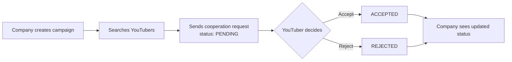
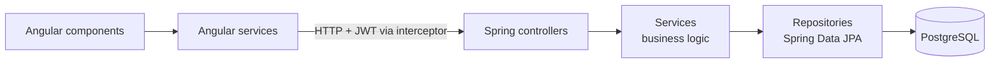
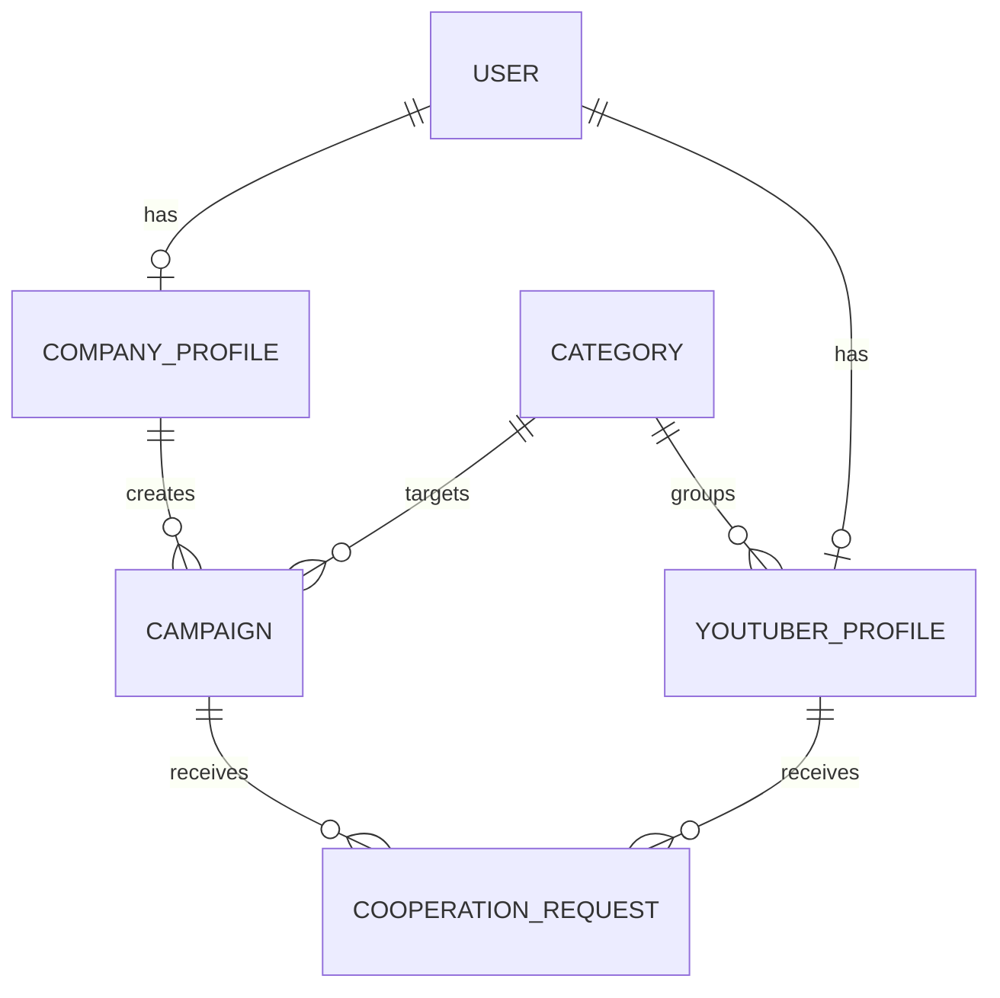

# AdConnect

**A full-stack platform that connects companies with YouTubers for advertising partnerships.**

Companies create ad campaigns, search for creators by niche, audience and price, and send cooperation offers. YouTubers build a channel profile, receive offers and accept or reject them. Both sides see each offer's status as it changes.

Built solo with **Angular 21**, **Spring Boot 3.5 (Java 21)** and **PostgreSQL**, secured with **JWT** and **Spring Security**.

> Screenshots: add 2–3 images here (company dashboard, YouTuber dashboard, creator search), e.g.
> ``

---

## Features

| Role | What they can do |
| --- | --- |
| **Company** | Create a company profile · create and manage campaigns (budget, deadline, target category) · search YouTubers · send cooperation offers · track the status of each offer |
| **YouTuber** | Create a channel profile (audience, average views, price per ad, category) · view incoming offers · accept or reject them |
| **Admin** | Create, edit and delete categories · view all users · platform overview with live totals |
| **Everyone** | Browse YouTuber profiles and filter by category, country, language, subscribers, average views and maximum price |

### The core workflow



---

## Tech stack

| Layer | Technologies |
| --- | --- |
| Frontend | Angular 21 (standalone components), TypeScript, HTML, CSS |
| Backend | Java 21, Spring Boot 3.5, Spring Web (REST), Bean Validation, Lombok |
| Database | PostgreSQL, Spring Data JPA, Hibernate |
| Security | Spring Security, JWT (jjwt), BCrypt password hashing |
| Testing | Postman (API), manual end-to-end testing in the browser |

---

## Architecture



The backend follows a layered structure: **controllers** handle HTTP, **services** hold the business rules, **repositories** talk to the database, and **DTOs** keep the API separate from the database entities. A **global exception handler** turns errors into consistent JSON responses (`400`, `404`, `409`, `500`).

### Data model



### Security

- Passwords are hashed with **BCrypt**; login returns a signed **JWT** (valid for 24 h).
- The API is **stateless**: a filter validates the token on every request.
- **Role-based access is enforced on the backend.** For example, only YouTubers can accept or reject requests, only companies can create campaigns, and only admins can manage categories. Angular route guards and an HTTP interceptor mirror this in the UI, but the backend is the real security boundary.
- Public sign-up is limited to YouTuber and Company accounts. Admin accounts are created directly in the database.

---

## API overview

| Method | Endpoint | Access |
| --- | --- | --- |
| `POST` | `/api/auth/register` · `/api/auth/login` | Public |
| `GET` | `/api/youtubers` · `/api/youtubers/{id}` | Public |
| `GET` | `/api/youtubers/search?category=&country=&language=&minSubscribers=&minAverageViews=&maxPrice=` | Public |
| `POST` / `PUT` / `DELETE` | `/api/youtubers/...` | YouTuber |
| `GET` | `/api/campaigns` · `/api/campaigns/company/{id}` · `/api/campaigns/category/{name}` | Public |
| `POST` / `PUT` / `DELETE` | `/api/campaigns/...` · `/api/companies/...` | Company |
| `POST` | `/api/requests` | Company |
| `GET` | `/api/requests/campaign/{id}` · `/api/requests/youtuber/{id}` | Logged in |
| `PUT` | `/api/requests/{id}/accept` · `/api/requests/{id}/reject` | YouTuber |
| `GET` | `/api/categories` | Public |
| `POST` / `PUT` / `DELETE` | `/api/categories/...` | Admin |
| `GET` | `/api/users` | Admin |

Admins can also use the YouTuber and Company endpoints.

---

## Getting started

### Prerequisites

- Java 21
- Node.js 20.19+ or 22 LTS, and npm
- PostgreSQL 14+

### 1. Create the database

```sql
CREATE DATABASE adconnect;
```

Tables are created automatically by Hibernate on first start.

### 2. Run the backend (port 8080)

Set the environment variables, then start Spring Boot:

```bash
cd backend

export DB_URL=jdbc:postgresql://localhost:5432/adconnect
export DB_USERNAME=postgres
export DB_PASSWORD=your_password
export JWT_SECRET=$(openssl rand -base64 32)

./mvnw spring-boot:run
```

On Windows (PowerShell), use `$env:DB_PASSWORD="your_password"` and so on, then `.\mvnw.cmd spring-boot:run`.

### 3. Run the frontend (port 4200)

```bash
cd frontend
npm install
npm start
```

Open **http://localhost:4200**.

### 4. Create an admin and some categories

Register a normal account in the app, then promote it to admin:

```sql
UPDATE users SET role = 'ROLE_ADMIN' WHERE username = 'your_username';
```

Log in again as that user and add categories (e.g. Gaming, Sports, Technology, Education) from the admin dashboard. Companies and YouTubers need categories to create campaigns and profiles.

---

## Project structure

```
backend/src/main/java/com/khaled/adconnect/
├── config/        Spring Security and CORS configuration
├── controller/    REST endpoints
├── dto/           Request and response objects
├── enums/         Role, RequestStatus
├── exception/     Custom exceptions and global handler
├── model/         JPA entities
├── repository/    Spring Data JPA repositories
├── security/      JWT service, auth filter, user details service
└── service/       Business logic

frontend/src/app/
├── auth/          Login and registration
├── guards/        Role-based route guards
├── interceptors/  Attaches the JWT to API requests
├── models/        TypeScript interfaces
├── pages/         Home, YouTuber search and details, three dashboards
└── services/      API clients and token storage
```

---

## Possible next steps

- Automated tests (JUnit and Mockito for services, integration tests for the API)
- Docker Compose setup for one-command startup
- Messaging between companies and YouTubers
- Pull channel statistics from the YouTube Data API

---

## Author

**Khaled Darwesh**, Computer Science student at Łódź University of Technology
GitHub: [@khaled694](https://github.com/khaled694)

Originally built as the course project for *Interactive Web Applications* (2026).
